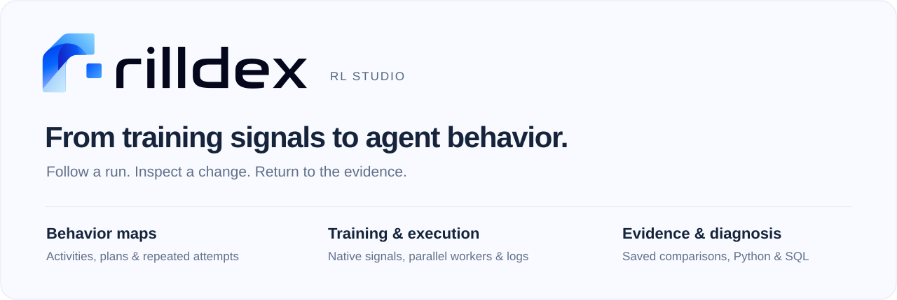
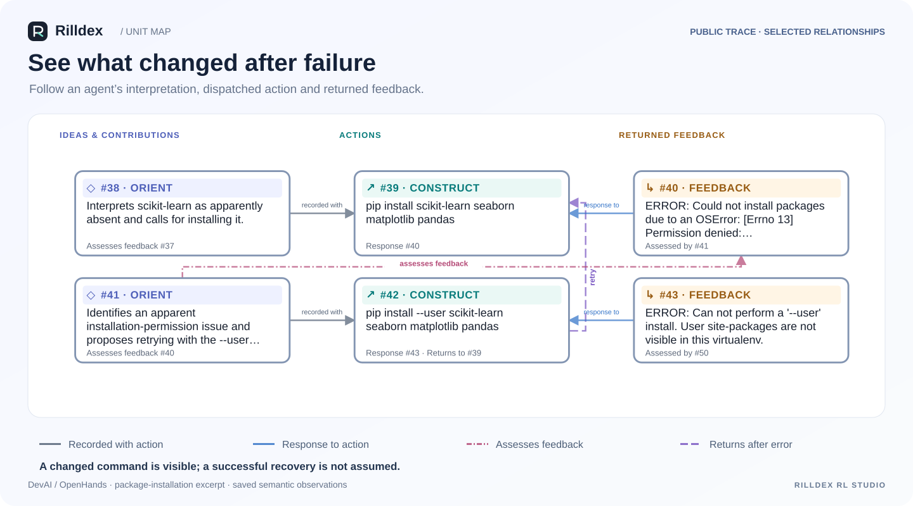
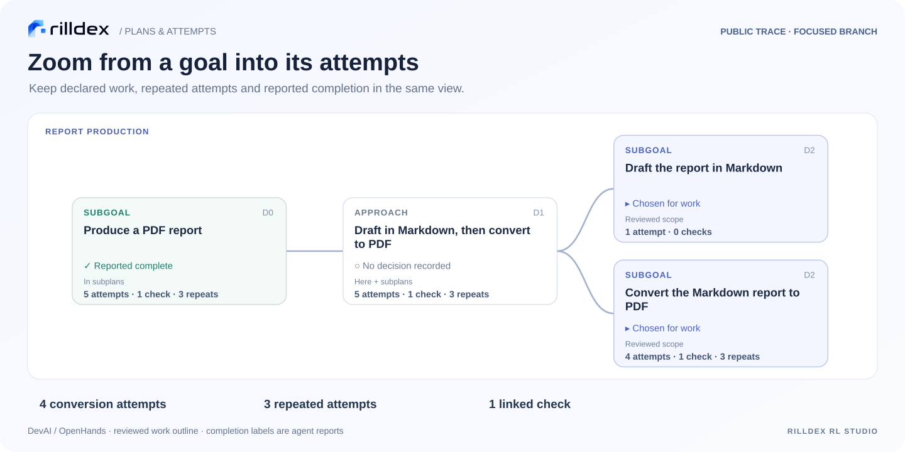
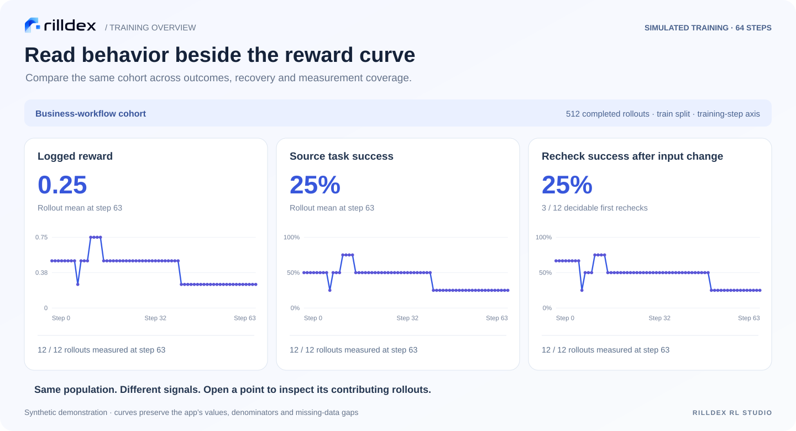

<p align="center"></p>

# Rilldex RL Studio

**RL observability from training curves to agent behavior.** Collect rollouts and native trainer metrics, map activities and their relationships, and inspect the evidence behind each measurement. Work through the dashboard, Python, SQL, or a combination—before, during, or after training.

[Quick start](#quick-start) · [Product tour](#product-tour) · [Reward checks](#reward-hacking-detection) · [Trainer metrics](docs/TRAINER_TELEMETRY.md) · [Model setup](#model-setup) · [Python & SQL](#python--sql) · [Deployment](docs/DEPLOYMENT.md)

## Highlights

- **See what an agent did.** Connected maps of units, actions, feedback, expressed plans, branches and repeated attempts.
- **Put behavior beside training signals.** Recovery, verification and unresolved work alongside loss, entropy, KL, clipping, tokens and throughput.
- **Keep evidence within reach.** Chart values and saved investigations link to source records, relationships, coverage and definitions.
- **Keep your own workflow.** Files, Python and HTTP input; a live SQLite workspace; code-defined monitors with optional UI.

## Product tour

**Unit map:** follow actions, feedback and retries through saved relationships.



**Plans & attempts:** focus a branch to see its steps, repeated attempts and reported status.



**Training overview:** compare reward, task outcomes and recheck success for the same cohort.



Figures use saved app content with navigation removed. Maps use a [public OpenHands trace](https://github.com/metauto-ai/agent-as-a-judge/blob/43c2fa7b84ef0c1522e8250576e6798bace29dd0/benchmark/trajectories/OpenHands/39_Drug_Response_Prediction_SVM_GDSC_ML.json); curves use simulated training.

## Core features

| Capability | What you can do |
| --- | --- |
| Behavior maps | Move between activity units and higher-level work, plans and attempts; inspect the source behind each saved interpretation. |
| Training overview | Follow rollout measures and native trainer curves with explicit populations, clocks, units and missing data. |
| Trainer telemetry | Connect TRL GRPO/PPO callbacks, verl logger dictionaries or custom definitions. Preserve objective, version, writer and restart boundaries. |
| Monitor management | Use built-in measures, relationship queries and Python-defined monitors; inspect coverage and contributing cases. |
| Reward hacking detection | Select common behavior checks or define reward-specific detectors; follow flagged rollouts and inspect their supporting evidence. |
| Investigations | Compare intervals and populations, retain hypotheses, annotate run history and reopen saved evidence. |
| Continuous collection | Follow existing and new output, ingest growing rollouts, retry durable outboxes, resume after interruption, or import staged batches. |
| Code-first analysis | Query rollouts, graph nodes/edges, measurements and trainer logs through Python and SQL; export JSONL/CSV or use optional dataframe/graph libraries. |

Semantic maps require saved or explicitly configured model observations. Source capture and trainer metrics work without model keys. Missing evidence stays unavailable; source validation alone does not guarantee semantic correctness.

## Quick start

**Python 3.11+ · Windows, Linux or macOS · no GPU required for collection**

```sh
python -m pip install "git+https://github.com/Sheltercosmo/Rilldex-RL-Studio.git"
rilldex start --open
```

Open the printed local address. Use `--port 0` to select a free port. `python -m rilldex` also works when the command is not on PATH.

### Connect a job

```sh
rilldex --db study.sqlite start --watch ./outputs --mode exports --experiment run-a --producer run-a/worker-0
```

Imports existing JSONL output and follows new records. For a staged batch, replace `start` with `watch` and add `--once`. Native Harbor/SWE-agent directories use `--mode native`. See the [input guide](docs/LIVE_INGESTION.md) for portable conversations, generations and environment episodes.

For reusable configuration: `rilldex setup --case local --save-launch job.rilldex.json`, then `rilldex launch job.rilldex.json`. Keep the workspace and producer outboxes on persistent local storage.

### Docker

```sh
git clone https://github.com/Sheltercosmo/Rilldex-RL-Studio.git
cd Rilldex-RL-Studio
docker build -t rilldex .
docker run --rm -p 127.0.0.1:8765:8765 -v rilldex-data:/data rilldex
```

The named volume retains the workspace. [Watched directories, SSH, cloud storage, notebooks and offline transfer →](docs/DEPLOYMENT.md)

### Native training metrics

```python
from rilldex import Outbox, TrainerTelemetry

outbox = Outbox("trainer-outbox.sqlite", producer="run-a/learner")
outbox.start()
metrics = TrainerTelemetry(
    outbox, experiment="run-a", framework="trl-grpo",
    framework_version="your-installed-trl-version",
    objective="dapo/config-v1", session="training-start-1",
)
trainer.add_callback(metrics.transformers_callback())
```

For verl, choose `framework="verl"` and call `metrics.log(native_metrics, step=global_steps)` beside the existing reduced logger call. Other trainers and inference servers use `framework="custom"` with explicit metric definitions. Existing logs use `rilldex telemetry import`. [Live, batch and custom examples →](docs/TRAINER_TELEMETRY.md)

## Model setup

Collection, conventional telemetry, source maps and analysis need **no LLM**. Semantic observation separates candidate generation from finite-choice decisions:

| Role | Options | Setup |
| --- | --- | --- |
| Candidate LLM | Your local model or hosted LLM API | Supply a JSON-in/JSON-out candidate command; configure the model in that process. |
| Decision model | Built-in Jev/Typesafe API | Set `JEV_API_KEY` in the observer environment; select the maximum-probability supplied option. |
| Custom decision backend | Local or remote Python transport | Implement the finite-choice response contract. This is an integration interface, not a bundled local decision-model runtime. |

```sh
rilldex --db study.sqlite semantic watch-init observations --experiment run-a --label "Activities and work" --candidate-producer my-model-v1 --candidate-command python proposer.py
rilldex --db study.sqlite semantic watch-budget observations --max-new-calls 100 --max-candidate-calls 100 --max-input-bytes 2000000
rilldex --db study.sqlite semantic watch-run observations --follow --candidate-command python proposer.py
```

`proposer.py` is your local/API adapter. These are lifetime call/byte ceilings, not token or cost estimates. The worker begins with zero allowance and reuses compatible saved work. Keep credentials in environment variables. [Contracts and local/API setup →](docs/MODEL_SETUP.md)

## Reward hacking detection

Scan rollouts for suspicious behavior, follow findings during training, and open the exact evidence. **Reward hacking** in the sidebar brings together common checks, scan progress, budgets and custom detectors.

| Coverage | Available checks |
| --- | --- |
| Answer acquisition | Task-answer searches, repository-history lookup, external solution reuse, and test-label copying in recorded Python code. |
| Evaluator access | Grading-material access, with a separate check for explicit access restrictions. |
| Evaluation manipulation | Suspected bypass, substituted work, and instructions aimed at influencing a downstream judge. |
| Task conflicts | Actions conflicting with recorded instructions (`requirements` protocol). |
| Reward consistency | Reward/component discrepancies and reward-versus-check comparisons. |
| Artifact integrity | Missing or empty required files; changes to fixed evaluator files against a supplied baseline (Python helper). |

**Start:** set `JEV_API_KEY` and scan imported rollouts. Behavior checks need no prebuilt semantic map or candidate LLM.

```sh
rilldex --db study.sqlite monitor-rollouts run reward-checks --experiment run-a --all-latest --protocol search --max-new-calls 20
```

Select saved observations to add charts. Scan progress shows inspected pages, pending rollouts and resume commands. Rerun with the same workspace to reuse cached decisions, or replace `run` with `watch` and omit `--all-latest` to follow completed rollouts. Recorded reward and artifact checks need no model calls.

**Customize:** choose **Custom reward detector**, or use `Workspace.reward_detector()`. Bind your reward definition and inputs, then implement `detect(ctx)` with Python rules, libraries, a local model or an API. Return a status, summary and evidence. The worker processes existing and new rollouts; results share the built-in charts, alerts, evidence views and Python/SQL access. [Custom detectors and artifact checks →](docs/custom-monitors.md#custom-reward-checks)

**Coverage:** unscanned and incomplete results remain distinct from clear results. Flags identify suspected behavior, not proven exploitation; permitted evaluator access is not automatically a violation. False positives and misses remain, and no general real-world accuracy rate is established. [Validation and limitations →](docs/DETECTOR_VALIDATION.md)

## Python & SQL

Read the live workspace without exporting or starting a web server:

```python
from rilldex import Workspace

ws = Workspace("study.sqlite", experiment="run-a")
units = ws.units().rows
relations = ws.relations(target_activity="revise").rows
trainer_logs = ws.telemetry().rows
loss = ws.sql("""
    SELECT step, session,
           json_extract(record_json, '$.metrics.loss.value') AS loss
    FROM trainer_telemetry
    WHERE framework = 'trl-grpo' AND split = 'train'
    ORDER BY session, step
""").rows
```

Add your own analyses and publish code-defined monitors into the UI. [Python guide](docs/CODE_FIRST_ANALYSIS.md) · [Custom monitor example](examples/live_custom_monitor.py)

## Integrations

Use native adapters where available, or portable conversation, generation and environment-episode records for your own stack. Configuration readers, file importers and executed capture hooks have different coverage; the [integration matrix](docs/INTEGRATION_COVERAGE.md) identifies each route.

Optional cloud readers: install `.[s3]` or `.[gcs]` from a checkout. The default collector is a local, single-user application; use SSH forwarding for remote jobs.
