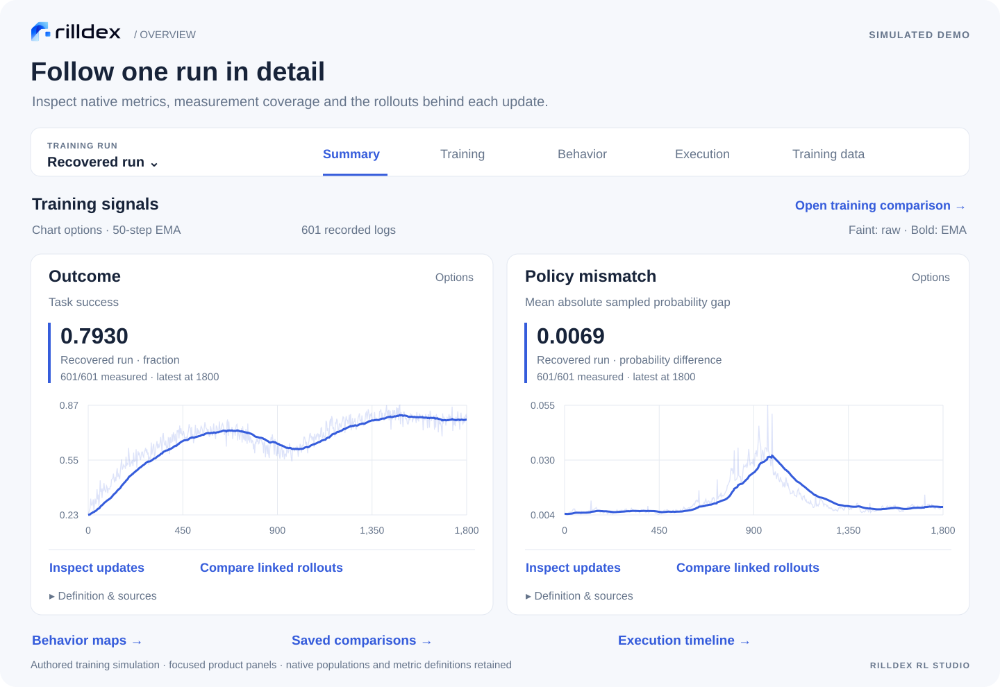
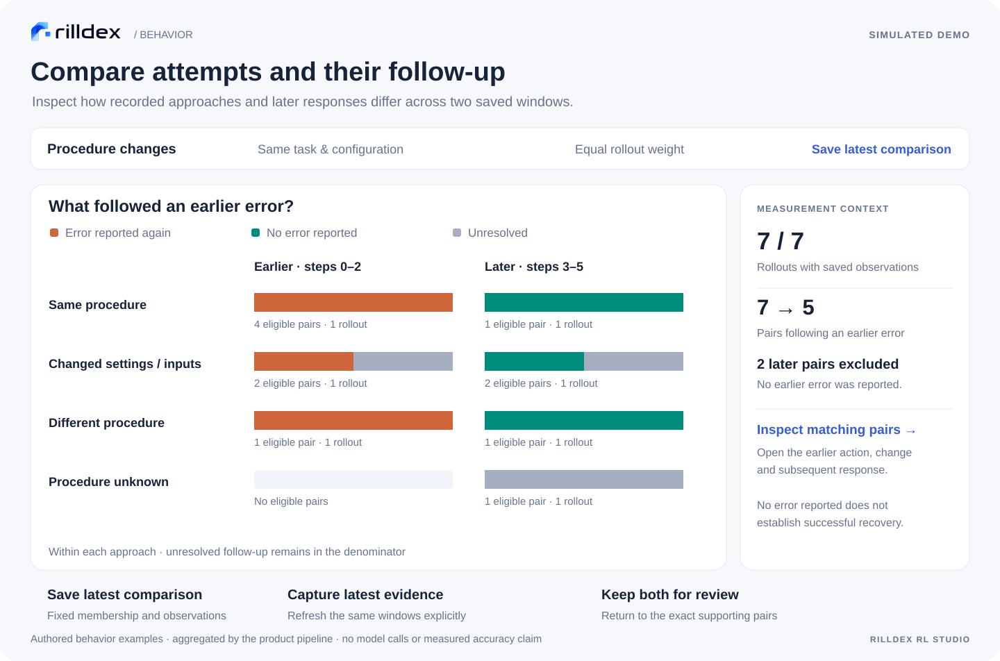
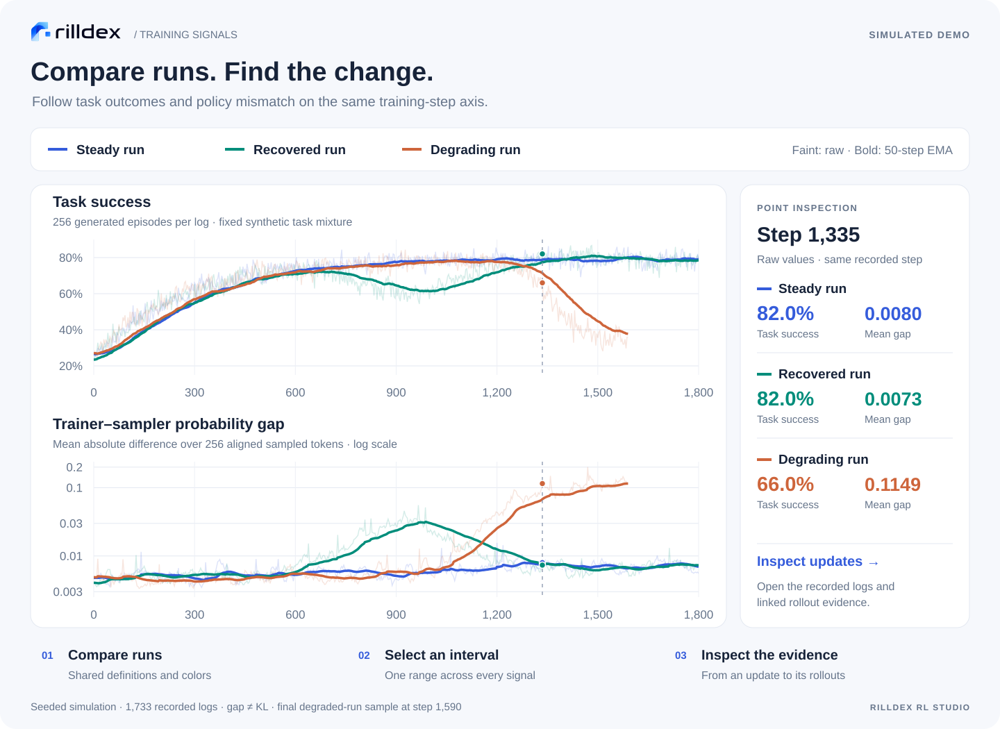
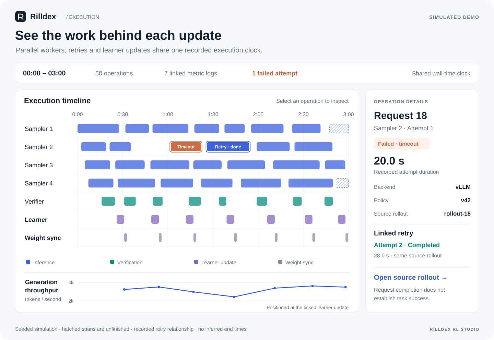

<p align="center"></p>

# Rilldex RL Studio

**RL observability from training curves to agent behavior.** Collect rollouts and native trainer metrics, map activities and their relationships, and inspect the evidence behind each measurement. Work through the dashboard, Python, SQL, or a combination—before, during, or after training.

[Quick start](#quick-start) · [Product tour](#product-tour) · [Reward checks](#reward-hacking-detection) · [Trainer metrics](docs/TRAINER_TELEMETRY.md) · [Model setup](#model-setup) · [Python & SQL](#python--sql) · [Deployment](docs/DEPLOYMENT.md)

## Highlights

- **See what an agent did.** Connected maps of units, actions, feedback, expressed plans, branches and repeated attempts.
- **Compare training runs.** Align reward, policy mismatch, loss, entropy, KL, clipping, tokens and throughput; select one interval across the charts.
- **Connect training to behavior.** Follow worker activity, learner updates and their linked rollouts; inspect recovery, verification and unresolved work.
- **Keep evidence within reach.** Chart values and saved investigations link to source records, relationships, coverage and definitions.
- **Keep your own workflow.** Files, Python and HTTP input; a live SQLite workspace; code-defined monitors with optional UI.

## Product tour

**Training overview:** keep one run selected and move between training, behavior, execution and data.



**Unit map:** follow actions, feedback and retries through saved relationships.


**Plans & attempts:** focus a branch to see its steps, repeated attempts and reported status.


**Rollout measures:** compare reward, task outcomes and recheck success for the same cohort.


**Behavior comparison:** compare recorded approaches and subsequent responses, inspect matching pairs, and save the evidence.



**Run comparison:** align outcomes and policy mismatch, select an interval, and inspect the recorded updates.



**Execution timeline:** follow parallel workers, a timed-out request and its retry alongside learner updates.



Maps use a [public OpenHands trace](https://github.com/metauto-ai/agent-as-a-judge/blob/43c2fa7b84ef0c1522e8250576e6798bace29dd0/benchmark/trajectories/OpenHands/39_Drug_Response_Prediction_SVM_GDSC_ML.json). Other figures use labeled, authored examples rendered as focused product views.

## Core features

| Capability | What you can do |
| --- | --- |
| Behavior maps | Inspect failed checks, retry paths and paired attempts; move between units, work and plans with source evidence attached. |
| Training overview | Start with a combined summary, then open focused Training, Behavior, Execution or Training data views. |
| Shared workspace | Switch the training run once across views. Search, pin investigations, and organize runs and projects separately from the live overview. |
| Run comparisons | Align up to three runs and inspect matching task rollouts. Compare behavior across all selected rollouts or equally weighted shared tasks, with saved measurements and maps attached. |
| Behavior comparisons | Compare activities, procedures and follow-up between intervals. Save exact membership and observations; capture later evidence without changing the original. |
| Run capture | Collect console logs, configuration, Python/Git context and available hardware signals; retain versioned file snapshots. |
| Trainer telemetry | Connect TRL, ms-swift GRPO or [Stable-Baselines3](docs/STABLE_BASELINES.md), import verl logs, or use custom definitions. Preserve objective, version, writer and restart boundaries. |
| Execution timeline | Inspect worker spans, failures, configuration and weight-sync events alongside linked signals and samples. Save a captured view or export it. |
| Policy mismatch | Measure aligned token probability gaps and compare probability-based and ratio-based exclusion rules using existing log probabilities. No additional inference required. |
| Monitor management | Use built-in measures, relationship queries and Python-defined monitors; inspect coverage and contributing cases. |
| [Detector validation](docs/DETECTOR_VALIDATION_SETS.md) | Freeze reviewed cases, compare detector versions, and inspect disagreements with coverage alongside accuracy. |
| [Findings reports](docs/FINDINGS_REPORTS.md) | Share offline reports with conclusions, counterevidence, cohort counts and exact saved evidence. |
| Reward hacking detection | Select common behavior checks or define reward-specific detectors; follow flagged rollouts and inspect their supporting evidence. |
| Investigations | Compare intervals and populations, retain hypotheses, annotate run history and reopen saved evidence. |
| Continuous collection | Follow existing and new output, ingest growing rollouts, retry durable outboxes, resume after interruption, or import staged batches. |
| Code-first analysis | Query rollouts, graph nodes/edges, measurements and trainer logs through Python and SQL; export JSONL/CSV or use optional dataframe/graph libraries. |

Semantic maps require saved or explicitly configured model observations. Source capture and trainer metrics work without model keys. Missing evidence stays unavailable; source validation alone does not guarantee semantic correctness.

## Quick start

**Python 3.11+ · Windows, Linux or macOS · no GPU required for collection**

```sh
python -m pip install "git+https://github.com/Sheltercosmo/Rilldex-RL-Studio.git"
rilldex start --open
```

Open the printed local address. Start with **Open an example**, import saved rollouts, or connect a running experiment. The included retry example needs no API key. Use `--port 0` to select a free port. `python -m rilldex` also works when the command is not on PATH.

### Connect a job

```sh
rilldex --db study.sqlite start --watch ./outputs --mode exports --experiment run-a --producer run-a/worker-0
```

Imports existing JSONL output and follows new records. For a staged batch, replace `start` with `watch` and add `--once`. Native Harbor/SWE-agent directories use `--mode native`. See the [input guide](docs/LIVE_INGESTION.md) for portable conversations, generations and environment episodes.

Already using Weave? [Import a saved calls export](docs/WEAVE_IMPORT.md) to retain call nesting, recorded model outputs, source links and available W&B run/step context.

For reusable configuration: `rilldex setup --case local --save-launch job.rilldex.json`, then `rilldex launch job.rilldex.json`. Keep the workspace and producer outboxes on persistent local storage.

### Docker

```sh
git clone https://github.com/Sheltercosmo/Rilldex-RL-Studio.git
cd Rilldex-RL-Studio
docker build -t rilldex .
docker run --rm -p 127.0.0.1:8765:8765 -v rilldex-data:/data rilldex
```

The named volume retains the workspace. [Watched directories, SSH, cloud storage, notebooks and offline transfer →](docs/DEPLOYMENT.md)

### Capture logs, hardware and files

```sh
rilldex --db study.sqlite record --project reasoning --name run-a -- python -u train.py
rilldex --db study.sqlite start --open
```

Or use Python:

```python
from rilldex import Run

with Run("run-a", project="reasoning", workspace="study.sqlite", config={"lr": 1e-6}) as run:
    run.log({"loss": 0.8}, step=1)
    run.add_file("config.yaml")
```

**Runs & projects** groups projects, pins or archives runs, and saves comparisons. **Run details** shows searchable console logs, configuration, Python/Git context, hardware history and versioned file snapshots. CPU/RAM capture uses the `system` install extra; NVIDIA samples use `nvidia-smi`. Unavailable sensors remain missing. [Remote capture, file limits and code access →](docs/RUN_CAPTURE.md)

### Native training metrics

```python
from rilldex import Outbox, TrainerTelemetry

outbox = Outbox("trainer-outbox.sqlite", producer="run-a/learner")
outbox.start()
metrics = TrainerTelemetry(
    outbox, experiment="run-a", framework="trl-grpo",
    framework_version="your-installed-trl-version",
    objective="dapo/config-v1", session="training-start-1",
)
trainer.add_callback(metrics.transformers_callback())
```

For verl, choose `framework="verl"` and call `metrics.log(native_metrics, step=global_steps)` beside the existing reduced logger call. Other trainers and inference servers use `framework="custom"` with explicit metric definitions. Existing logs use `rilldex telemetry import`. [Live, batch and custom examples →](docs/TRAINER_TELEMETRY.md)

### Inspect a run

Use the **Training run** switcher in the sidebar; the selection follows you across views. **Summary** previews training signals and rollout measures; **Training** compares full runs. Select an interval, then **Inspect updates** to open original logs and linked rollouts. **Browse metrics** finds additional signals; **Export comparison** downloads raw records or the plotted view. Ordinary trainer logs are enough to start.

**Behavior** contains measures, distributions and strategy profiles. **Execution** shows timing recorded with `ExecutionRecorder`; **Training data** follows generation, scoring, selection and learner use. Each view keeps the selected experiment and environment. [Execution capture and probability comparisons →](docs/TRAINER_TELEMETRY.md#execution-and-training-signals)

In **Behavior → Distributions**, select two windows and an activity or procedure category to inspect matching cases. **Save latest comparison** retains its observations and membership. **Capture latest evidence** revisits the same windows while preserving the original.

Comparisons retain recorded clocks, populations and metric definitions. Training steps do not imply equal compute; sampled probability gaps are not full-distribution KL. Replayed exclusion rules describe supplied tokens, not predicted training outcomes.

## Model setup

Collection, conventional telemetry, source maps and analysis need **no LLM**. Semantic observation separates candidate generation from finite-choice decisions:

| Role | Options | Setup |
| --- | --- | --- |
| Candidate LLM | Your local model or hosted LLM API | Use the installed chat-completions adapter or your own JSON candidate command. |
| Decision model | Built-in Jev/Typesafe API | Set `JEV_API_KEY` in the observer environment; select the maximum-probability supplied option. |
| Custom decision backend | Local or remote Python transport | Implement the finite-choice response contract. This is an integration interface, not a bundled local decision-model runtime. |

Set `RILLDEX_LLM_PRESET=local` (or `ollama`), `RILLDEX_LLM_MODEL`, and `JEV_API_KEY`. Hosted endpoints use `RILLDEX_LLM_URL` and, when required, `RILLDEX_LLM_API_KEY`.

```sh
python -m rilldex.models check
python -m rilldex.models pilot ./pilot --db study.sqlite --run-id ROLLOUT_ID --candidate-calls 20 --decision-calls 20 --input-bytes 1000000
```

**Data & workflows → Models** provides configuration templates, rollout selection and the same resumable pilot. Limits are lifetime call/byte ceilings; saved work is reused. [Local/API setup and continuous observation →](docs/MODEL_SETUP.md)

## Reward hacking detection

Scan rollouts for suspicious behavior, follow findings during training, and open the exact evidence. **Reward hacking** in the sidebar brings together common checks, scan progress, budgets and custom detectors.

| Coverage | Available checks |
| --- | --- |
| Answer acquisition | Task-answer searches, repository-history lookup, external solution reuse, and test-label copying in recorded Python code. |
| Evaluator access | Grading-material access, with a separate check for explicit access restrictions. |
| Evaluation manipulation | Suspected bypass, substituted work, and instructions aimed at influencing a downstream judge. |
| Task conflicts | Actions conflicting with recorded instructions (`requirements` protocol). |
| Reward consistency | Reward/component discrepancies and reward-versus-check comparisons. |
| Artifact integrity | Missing or empty required files; changes to fixed evaluator files against a supplied baseline (Python helper). |

**Start:** set `JEV_API_KEY` and scan imported rollouts. Behavior checks need no prebuilt semantic map or candidate LLM.

```sh
rilldex --db study.sqlite monitor-rollouts run reward-checks --experiment run-a --all-latest --protocol search --max-new-calls 20
```

Select saved observations to add charts. Scan progress shows inspected pages, pending rollouts and resume commands. Rerun with the same workspace to reuse cached decisions, or replace `run` with `watch` and omit `--all-latest` to follow completed rollouts. Recorded reward and artifact checks need no model calls.

**Customize:** choose **Custom reward detector**, or use `Workspace.reward_detector()`. Bind your reward definition and inputs, then implement `detect(ctx)` with Python rules, libraries, a local model or an API. Return a status, summary and evidence. The worker processes existing and new rollouts; results share the built-in charts, alerts, evidence views and Python/SQL access. [Custom detectors and artifact checks →](docs/custom-monitors.md#custom-reward-checks)

**Coverage:** unscanned and incomplete results remain distinct from clear results. Flags identify suspected behavior, not proven exploitation; permitted evaluator access is not automatically a violation. False positives and misses remain, and no general real-world accuracy rate is established. [Validation and limitations →](docs/DETECTOR_VALIDATION.md)

## Python & SQL

Read the live workspace without exporting or starting a web server:

```python
from rilldex import Workspace

ws = Workspace("study.sqlite", experiment="run-a")
units = ws.units().rows
relations = ws.relations(target_activity="revise").rows
trainer_logs = ws.telemetry().rows
execution = ws.execution_view()  # recorded spans and linked logs/samples
loss = ws.sql("""
    SELECT step, session,
           json_extract(record_json, '$.metrics.loss.value') AS loss
    FROM trainer_telemetry
    WHERE framework = 'trl-grpo' AND split = 'train'
    ORDER BY session, step
""").rows
```

Add your own analyses and publish code-defined monitors into the UI. [Python guide](docs/CODE_FIRST_ANALYSIS.md) · [Custom monitor example](examples/live_custom_monitor.py)

## Integrations

Use native adapters where available, or portable conversation, generation and environment-episode records for your own stack. Configuration readers, file importers and executed capture hooks have different coverage; the [integration matrix](docs/INTEGRATION_COVERAGE.md) identifies each route.

Optional cloud readers: install `.[s3]` or `.[gcs]` from a checkout. The default collector is a local, single-user application; use SSH forwarding for remote jobs.
