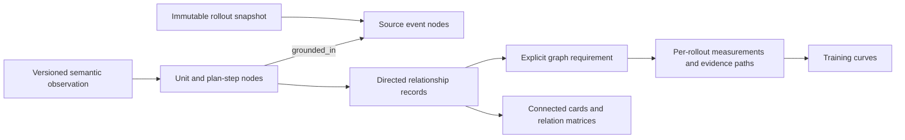

# Graph-backed rollout inspection

8 October 2026. The rollout's connections are persistent data. Figures and metric queries are projections of that data.

## Data architecture

`tracker/graph_store.py` implements an embedded property graph in the existing SQLite database. This is not a Neo4j service or a screen-only graph: `graph_nodes` stores typed nodes and properties, and `graph_edges` stores directed source/target/type/property records with foreign keys and incoming/outgoing/type indexes. `rollout_graphs` binds each immutable graph version to one rollout source and one observer. `graph_requirements` stores reusable measurement definitions.



Source events retain native action/response identity and recorded order. Semantic units retain their activity, natural-language content, source span and decision references. Plan steps are distinct nodes. Observed semantic relations retain their original payload, including request hashes, evidence and cutoffs where recorded. An unmaterialized endpoint becomes an explicit unresolved reference, never a fabricated semantic unit. Source order is its own edge type and does not imply causation.

Graphs have content-derived identities, immutable source hashes and annotation hashes. Changed annotations create another graph, rather than overwrite an old one. Full graph exports retain semantic provenance and review notes; notes are not silently applied as replacement edges. Missing edges do not mean absent behavior. Persisting an experimental observer does not establish its accuracy.

New imports and ingestion revisions create source graphs within the source transaction. Saving/measuring a semantic map also saves its graph atomically with its measurement. Existing data can be indexed with:

```text
python -m research.index_rollout_graphs
```

The current local index contains 3,088 rollout sources and 15 current semantic graph snapshots. The latter are selected existing observers, not semantic coverage over all 3,088 rollouts. Historical graph versions remain available by ID. The current catalog excludes superseded producer snapshots.

## A researcher workflow

1. Open **Training curves** and choose reward, output length, penalties, repeated dispatches or another available metric. Binary frequency curves lead with positive/decidable rates; unknowns stay separate. A bin marker selects contributing measured rollouts. Enable individual rollout values to open a source directly. The source drawer links into the graph.
2. Open **Relation lab** and select a rollout plus observer. Examine the activity-transition matrix, relationship structure or connected cards. A node opens its source properties; an edge opens its exact stored relation.
3. Write the research question and define its executable fields. Save the definition and export the result with graph IDs and evidence paths.
4. Select the current rollout or all current graphs from the same observer. Results retain per-rollout counts; compatible populations with recorded training coordinates also produce training curves. Cohorts separate environment, sampling, source selection and other recorded measurement context.

The workspace checks for new database state every 15 seconds while the page is visible. “Checked” describes a successful source check; it does not assert that a training producer or diagnostic worker is running. The Follow imports control enables refreshing changed views. An active training-bin selection or query result is retained, with a new-data notice, until explicit refresh. This is page-local polling, not a scheduled background automation.

## Exact requirement contract

For example:

```json
{
  "schema": "graph-requirement/1",
  "question": "How often is information seeking followed by an explicit revision?",
  "anchor_activity": "inspect",
  "relation": "revises",
  "within_units": 8,
  "require_evidence_link": false,
  "require_new_exploration": false
}
```

The question is a saved research note. The fields are the executed definition; this first implementation does not claim unrestricted natural-language-to-query translation. It never executes supplied SQL or code.

The denominator is the number of matching annotated starting units. For each, inspect the next `within_units` **agent units in the same trajectory**. A match requires a later unit with the named outgoing relationship to a materialized earlier object. One anchor counts at most once, even when several edges match. The source and target IDs and supporting edges remain in the result. The window is measured in recorded units, not wall-clock time.

`require_evidence_link` additionally requires a stored `uses_evidence` or `responds_to` edge from the later unit back to the starting unit. This establishes a recorded link, not causal influence. `require_new_exploration` requires an explicit `facets.new_exploration` judgment on the starting unit; the activity Inspect is not used as a substitute. Unknown novelty contributes to missing coverage and cannot enter that denominator.

### Connected evidence paths (version 2)

The default is now **assessment of feedback returned by that inspection**, rather than any assessment near it. The version-1 requirements above remain readable and saved originals are retained. Editing an old definition in the UI creates a version-2 definition. A distinct `graph-pattern-evaluation/3` engine identifier is retained in results and training cohorts, separately from the definition schema. Windows and evidence paths stay within their recorded source context. Assessment, evidence-use and revision links share the map's source, actor, order and supplied-citation checks. Rejected links remain inspectable; a missing match is not behavioral absence.

```json
{
  "schema": "graph-requirement/2",
  "question": "How often does the agent assess feedback returned by that inspection?",
  "anchor_activity": "inspect",
  "relation": "assesses",
  "within_units": 8,
  "require_new_exploration": false,
  "evidence_path": {
    "start": "relation_target",
    "hops": [{"direction": "outgoing", "relations": ["feedback_for"]}]
  }
}
```

The later assessment points to feedback; that feedback must point to the exact starting inspection via `feedback_for`. A revision can instead start its path at `relation_source`, traverse `uses_evidence` or `responds_to` to feedback, then `feedback_for` to the inspection. The UI permits one to three hops in either stored-edge direction. A hop can have alternative relationship types (OR); sequential hops are all required. The final object must be the starting unit. These are fixed-length simple paths, not arbitrary graph programs or an unbounded query language.

Every intermediate object must be materialized, belong to the same trajectory, and be available by the later unit's cutoff. Unknown within-event offsets cannot establish same-event availability. A raw event includes its whole recorded text. Explicit relationship cutoffs that are later or unresolvable cannot support a match. The search fails visibly after 50,000 examined path edges per graph, without publishing an incomplete negative or rate.

Each matched relationship returns one complete deterministic witness, with node IDs, edge IDs and traversal directions; it does not enumerate all possible paths. Multiple matches still count the starting unit only once. Clicking a match displays the complete witness plus its assessed/revised object, and each match is individually inspectable. `evidence_path: null` deliberately retains temporal-only analysis and displays that qualification.

On the unchanged software graph, the old temporal query yields 15 assessment matches over six of nine inspection anchors. The connected query yields four matches over four anchors. This difference is a change in the measurement definition, not improved agent behavior or a semantic-accuracy estimate. [Exact source pairs, definitions and reproducible review](../research/graph-evidence-paths-2026-10-08/README.md).

The current output is **recorded match fraction**, not a calibrated behavioral revision rate. A starting unit without a matching edge has unknown underlying behavior because semantic relation coverage is incomplete. `behavior_rate` therefore stays unavailable. This distinction prevents a sparse annotation graph from manufacturing negative labels. A true behavioral rate needs an evaluated detector and explicit complete decision coverage over its eligible windows.

Training aggregation sums matched anchors and eligible anchors, rather than averaging per-rollout percentages. Each query population uses one observer and one annotation snapshot per rollout. Historical graphs and incomplete/failed producer snapshots remain inspectable but are excluded from current training curves. Missing training steps are not inferred. The current examples do not have the joint semantic coverage and training provenance needed to demonstrate a relation learning curve.

## Interfaces

| Interface | Purpose |
|---|---|
| `GET /api/graphs` | Current graph catalog and retained-version count |
| `GET /api/graphs/<graph_id>` | Immutable nodes, edges, provenance and matrices |
| `GET /api/workspace-status` | Cheap source-change fingerprint and timestamps |
| `POST /api/graph-query` | Evaluate `{graph_ids, requirement}` over 1–100 selected graphs |
| `GET /api/graph-requirements` | Presets and saved requirements |
| `POST /api/graph-requirements` | Save a versioned explicit requirement |

Current query execution loads the selected graph snapshots into memory; the adjacency tables are indexed but this is not yet a distributed graph-query engine. The inspector renders a bounded local neighborhood and links to the existing full Behavior map. Larger experiments will need indexed population cursors, incremental materialized metrics and pagination beyond the current query bound.

The graph detail API also includes derived matrices for the UI. **Export graph** downloads the immutable graph core without these derived views, preserving its content-hash contract.

The next semantic extension should be driven by a precise missing property, such as new-direction evidence or target-specific revision completeness. It should not add an overlapping primary activity merely to make a query produce a number.
