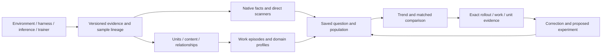

# RL behavior investigation framework

**Next-check comparison — 11 October:** Outcome and captured input changes now have independent categories in a versioned analysis operator. This supports first-retry success comparisons without requiring a change in the success definition. The existing monitor/question/case workflow exposes overall, changed-input and unchanged-input measures, with unknown membership retained. [Contract](NEXT_CHECK_OUTCOMES.md) · [Evidence](../research/next-check-outcomes-2026-10-11/README.md). The controls validate mechanics and source compatibility, not semantic revision accuracy or causal improvement.

Controlling direction, revised 12 October 2026. Build a **behavior investigation layer connected to the RL training loop**. The product's main unit is a saved research question with a population, evidence requirements, executable measurement, validation record and exact cases. A researcher should be able to explain a change and choose a useful next experiment. Framework support, labels and charts are means to that result.

**Recipe scope correction — 12 October:** the [modern-method review](../research/modern-rl-recipes-2026-10-12/README.md) extends the PPO/GRPO-heavy framing to single-rollout actor-critic, sequence and smooth objectives, teacher/self-distillation, partial rollout and staged multi-teacher training. Model composable supervision, credit, objective, execution and stage context; framework or algorithm names cannot determine the dashboard. The [observation contract](TRAINING_RECIPE_OBSERVATIONS.md) now supports immutable declarations, independently pinned generation/use context and capability selection. [Conformance and transport evidence](../research/recipe-context-2026-10-12/README.md) covers teacher-only, critic, group and hybrid controls. RL methods take priority over further distillation work. The [framework-aware setup increment](../research/framework-training-setup-2026-10-12/README.md) adds deterministic config interpretation and automatic native TRL context capture. [Native policy-loss derivative capture](POLICY_GRADIENT_OBSERVATIONS.md) now has CPU noninterference, analytic boundary and independent gradient controls. Bounded summaries and semantic-token alignment remain necessary before default large-run behavior exposure. Next deepen critic credit and asynchronous policy lineage; authored controls do not establish native integration. Existing group/scalar-use diagnostics do not establish universal learning health. Semantic accuracy and the selection/recovery workflow remain delivery gates.

**RL method adaptation — 12 October:** [The native-settings increment](RL_METHOD_ADAPTATION.md) adds pinned OpenRLHF and slime readers, pure-native conformance checks, allowlisted namespace export and question-led monitoring priorities. Single-rollout batch baselines, prompt baselines, GAE, sequence ratios, masks/caps, score centering and partial-rollout lineage remain distinct. The [source review](../research/rl-method-adaptation-2026-10-12/README.md) records exactly what is implemented versus still requiring capture. Distillation is not the implementation priority. Framework-specific parsing feeds shared evidence contracts; users should not define each chart or tune generic thresholds manually.

The strongest implemented foundation is versioned source evidence, graph snapshots, a training sample ledger and reusable analysis operations. The weakest link is independently validated semantic extraction. Separately wired observers and additional development examples have not resolved that weakness. Consolidation and a complete researcher workflow take priority over another isolated detector.

**Long-run comparison increment — 15 October:** the [window comparison workflow](MONITORING_WORKSPACE.md#compare-training-windows)
now applies the same cohort, missingness and opportunity arithmetic to saved source,
semantic and relationship monitors. It retains an immutable population and exact
case receipts, reports coverage/task-mix changes and offers baseline-weight
standardization when configuration fields match. Dashboard reads are consistent
WAL snapshots; stale annotations display as pending and changed result indexes
trigger reconciliation. The longitudinal simulation checks the product comparison
API as well as chart arithmetic, delayed completion, restart and archive restore.
This is descriptive investigation support; causal explanations, independent
semantic accuracy and distributed trainer scale remain separate validation gates.

**Training-to-unit connection — 12 October:** [Training coverage](TRAINING_UNIT_COVERAGE.md) now joins one recorded use to a pinned behavior graph using exact native target/source anchors. The existing map shows eligible tokens and zero/nonzero policy-loss derivatives by saved activity and unit, with unresolved and boundary-crossing positions excluded explicitly. A native TRL control validates source binding and noninterference; a separate public trace with synthetic training values exercises existing semantic maps. These do not establish independent semantic accuracy, causal credit, or production-scale capture. Population trends must preserve annotation versions and coverage before this can support comparisons of learned macro behavior.

**Immediate delivery decision:** make the existing selection and recovery investigations usable from connection setup through evidence correction. Connection preflight must distinguish captured evidence, missing instrumentation, pending observation and validation scope for the chosen question. Investigation context must carry task/configuration mix, scorer health, selection/use and observation coverage beside the behavior change. These checks prevent a failed verifier, incomplete import or changed task mix from being presented as policy regression. The [follow-up community review](../research/universal-rl-review-2026-10-11/README.md#follow-up-engineer-workflow-before-another-integration) records the supporting reports and the remaining UI gap. This is planned consolidation, not a claim that those checks are already integrated.

**Implemented evidence-check increment:** connection setup now joins a chosen question to recorded training populations, a selected monitor, current input identities and exact cases. It separates missing/stale/unresolved evidence, sample versus source coverage, cohort splits and validation scope, then carries selection into the comparison or recovery into its focused monitor. Score statuses remain distinct from numeric rewards. One read-only snapshot binds pagination. [Implementation, native replay and browser evidence](../research/question-readiness-2026-10-11/README.md). Task-mix diagnosis, scorer-health inference, independent semantics and full correction/experiment workflow validation remain open; this is evidence accounting rather than automatic explanation.

Universal support is demonstrated by transferring the same investigation across reasoning and stateful tool tasks with domain-specific criteria. The core preserves identity, evidence, work relationships and population arithmetic; a domain profile supplies what constitutes the same work, a comparable check and a relevant outcome. Validate recovery/selection measures, missed cases and correction effort before adding another macro label or framework entry. Retain the broader exploration, method reuse, deviation and recurrence goal, with explicit evidence requirements for each interpretation.

The [RL engineering workflow review](../research/rl-engineer-workflows-2026-10-11/README.md) makes the next product decisions concrete: preserve execution, per-call visible context and training-input mappings separately; offer investigation recipes with explicit populations; finish selection/recovery before expanding the detector catalog. Its original v1 contract probes exposed the conflation of episode and sample identity. The opt-in [independent sample contract](INDEPENDENT_TRAINING_SAMPLES.md) now supports several separately scored/selected/used samples per pinned episode, with explicit sample versus source-rollout weighting. Native multi-sample export, per-call context and generation segments remain migration targets; the normalized contract is not proof of universal integration.

The [community and code review](../research/universal-rl-review-2026-10-11/README.md) sharpens that direction: a universal framework needs explicit sample/group/lifecycle semantics and reusable observation execution, not just a common import envelope. The subsequent [operator migration](ANALYSIS_OPERATORS.md) moves all 18 deterministic analysis operations into shared execution/dependency descriptors. Automatic semantic observation execution remains separate. The four-kind training ledger is a foundation, not a complete lifecycle model. The design below labels the remaining work; it does not claim those extensions are deployed.

## A shared core with domain extensions

The universal part is **identity, evidence, relationships, measurement and comparison**. Domain meanings remain configurable: a patch, a mathematical claim and a reservation cannot share one universal definition of progress or success.

| View of the same evidence | Stable objects | Engineering question |
| --- | --- | --- |
| Training process | Experiment, configuration, task instance, attempt, generation segment, score, selection decision, training use | What was requested, generated, scored, admitted and consumed? |
| Agent work | Coherent contribution, activity, readable target, work subject, versioned state, supported relationship | What work was pursued, what changed, and what result followed? |
| Investigation | Population, question, clock, comparison, measurement, validation record, exact cases | Did behavior change under comparable conditions, and what should we test next? |

These views reuse our existing stores and graph indexes. They need no second database or execution engine. Physical execution nesting and logical work relationships coexist; neither replaces the other.

Generalization should mean adding a producer or domain definition without changing chart arithmetic, identity rules or the common UI.

| Extension contract | Required declaration | Shared machinery |
| --- | --- | --- |
| Capture adapter | Native identities, revision, event/arrival clocks, actor/context visibility, retained fields and information loss | Idempotent intake, durable delivery, immutable sources, lineage joins |
| Observation operator | Input capabilities, source cutoff, output schema, evidence references, version, coverage and cost | Dependencies, caching, bounded scheduling, review and invalidation |
| Measurement | Opportunity, relation/window predicate, criterion, numerator/denominator, weighting, unknown/censoring policy | Per-rollout results, cohort aggregation, charts and exact cases |
| Domain profile | Work objects, criteria, permissible state comparisons, optional phases and reviewed examples | Generic work visits, relationship paths, recovery and comparison |
| Investigation recipe | Research question, population, matching, operators, measurement definitions, views and a proposed follow-up experiment | The same setup, preflight, execution, review, comparison and export workflow |

The optional [token-context contract](TRAINING_TOKEN_CONTEXT.md) now preserves generation/export arrays, loss masks, token policy versions and a logical episode reference through the same ledger and saved investigation. Its experimental AReaL bridge is source-component tested; native package/trainer validation remains open. These are direct engineering facts, distinct from semantic work interpretations and actual learner consumption.

### Identity before universal interpretation

The normalized model must distinguish a task instance, an attempted environment episode, a model interaction or generation segment, a training sample, a prompt group and a training use. Their relationships can be one-to-many. A retry can create a new attempt; a reused sample does not become a newly generated rollout. Local optimizer application, durable checkpoint inclusion and the currently resumed training branch are separate facts. Planned lineage extensions must preserve these distinctions without rewriting old records.

Maintain three typed relationship families: **execution and training lineage**, **semantic work relationships**, and **analysis dependencies**. They can share storage and identifiers, but a parent span does not imply semantic support, chronological adjacency does not imply causality, and an analysis dependency is not an agent action. A span or training sample may overlap several contributions; retain explicit mapping and unmapped coverage instead of pretending their boundaries coincide.

The core guarantees identity, order where known, provenance, visibility, units of measurement, versioning and missingness. Domain profiles define what counts as the same work, a meaningful alternative, a comparable check or success. A profile may add namespaced observations without changing common aggregation or frontend code. The base activity vocabulary is a versioned shared starting point, not a claim that one frozen ontology covers all possible tasks.

Capture a versioned task/environment manifest with the requested outcome, evaluation rules, tool contracts, allowed changes and protected evaluator inputs when those are known. Keep agent-visible instructions separate from evaluator-private facts. This adopts OEB's useful boundary between general measurement rules and a task's stated world. It lets the same detector distinguish legitimate test maintenance from forbidden grader modification without treating every test edit as reward hacking. Missing rules remain a missing prerequisite, not permission for the observer to invent them.

Keep environment, harness, inference backend, trainer and observer versions separate. Preserve task hierarchy and evaluator identity instead of flattening them into one environment name. Retain native fields beside their normalized projection. Tokens, masks and log probabilities require native alignment; decoded text cannot reconstruct them. Optional modalities need suitable observers. A future OpenTelemetry bridge must pin its evolving conventions and preserve unmapped attributes.

Observation operators may use native facts, deterministic rules, Jev selection or a direct detector. Full graph construction is optional for a source-answerable question. Jev selects the raw maximum-probability supplied option; retrieval, candidate quality, scheduling and review are optimized outside selection. A common observation contract should wrap existing stages before replacing them. The current analysis registry is not yet a general observation plugin API.

**Implemented consolidation:** the analysis contract now advertises accepted/preferred observer inputs to backend validation and monitor setup. The UI no longer prefers a particular software observer or maintains an analysis-operation routing list. Source coverage inspection remains available where previously supported; it does not supply semantic measurements. Routing metadata stays outside saved measurement identities. [Implementation and tests](../research/engineering-consolidation-2026-10-11/README.md).

### One operator interface and several ways to observe

The deterministic executor now has registered descriptors for parameters, source binding, dependency declarations, version identity, evidence requirements and execution. Validation, execution, preflight and monitor observer routing use those registrations, while old result identities and receipts are retained. [Contract and migration evidence](ANALYSIS_OPERATORS.md). Extend this foundation with semantic observation scheduling, typed output schemas, incremental invalidation policy, cost accounting and renderer/measurement declarations. An installed Python operator is a trusted extension; a browser query is declarative and cannot upload arbitrary executable code.

An observation result needs a subject, predicate/value, exact evidence references, observation method/version, source cutoff and coverage state. Keep applicability, evidence completeness and execution status separate: not applicable, not captured, not inspected, unresolved and pending are different conditions. A negative semantic claim requires declared inspection coverage. A finding adds an interpretation; a metric adds a population and reducer. Neither should silently alter the source observation.

For readable targets and relations, prefer native structured fields, exact source spans and deterministic candidate construction where they express the required meaning. Jev can select among those candidates; it cannot invent a missing target or referent. Evaluate retrieval and candidate recall separately from selection accuracy. Use a generative proposer only for demonstrated coverage gaps, retain its provenance/cost, and allow unresolved results rather than force a plausible option.

Use three cooperating paths: native/deterministic facts on all captured data; reusable semantic observations on the configured population; and targeted direct scans for new questions. Direct scans may later reuse or enrich the graph. An exploratory finding becomes a recurring monitor only after its predicate, opportunities and validation are reviewable. Jev remains the raw argmax over supplied options; evidence retrieval, candidate proposal, sampling and budgets are outside that decision.

Full unit annotation remains a supported objective for a selected rollout. It is not a prerequisite for every useful source-based metric. Broad automatic semantic monitoring must earn its coverage, accuracy and cost claims rather than inherit them from deterministic capture.

## Semantic and macro observations

**Path-level validity gate:** the [saved-selector audit](../research/path-selection-audit-2026-10-11/README.md) shows why a macro interpretation needs its complete witness path tested. An older experimental native-relation selector achieved 168/183 verification-pair agreement but recovered only 1/6 offered native positive links; both of its selected checking paths disagreed with paired native references. This is a development-component result, not current product-observer accuracy. Evaluate missing jobs, missing candidates, wrong purpose, wrong referent and spurious compositions separately. Freeze complete-path cases and source sampling before changing the observer, and keep native taxonomy agreement distinct from independent product-specific adjudication.

Preserve the construction order:

`source → coherent unit → one primary activity → category-specific content → supported relationships → work episodes → population measurements`

A unit is coherent work at a declared scale, not necessarily a sentence or tool call. Keep one primary activity at that scale. Actor, modality and intended/executed status may be orthogonal facets. An immediate announcement such as adding a decorator is usually Orient, not a large Plan. Assess and revise refer to earlier items and belong in relationships.

Extract readable content that serves inspection: situation and immediate target for Orient; organized stages/dependencies for Plan; premises/conclusion for Reason; a proposed explanation for Hypothesize. Relations retain actual endpoints, supporting spans and the information cutoff. Requested objectives, inferred targets, completion claims and verified state remain distinguishable.

Use macro dimensions rather than force every episode into one strategy label:

| Dimension | Supported observation | Boundary |
| --- | --- | --- |
| Work direction | Continue, switch, return, unresolved membership | Requires work identity; first recorded is not proven novelty |
| Method | Reuse, reconfigure or replace a procedure | Requires comparable same-work attempts |
| Evidence response | Reference feedback, revise a claim, change relevant work | Requires the prior referent, visibility and a response window |
| Validation and outcome | Check attempted, local criterion passes, artifact delivered, task outcome | Named criteria and applicable state; claims are separate |
| Effort allocation | Recorded time/tokens/visits by work | Interpret within task, difficulty, budget and coverage |

Exploration needs supported alternatives or a defined novelty comparison. Deviation needs an objective/plan and authorization context. Return needs work identity. Progress needs a criterion. Stronger interpretations are validated domain projections, not synonyms for searching, switching, recurrence or positive reward.

Use one work map with visits and relationships, expandable into units and source. A single rollout uses a readable sequence/map; population flows use real counts and declared alignment. Strategy profiles summarize distributions on matched tasks, not an intrinsic model personality. Preserve existing observer versions and immutable corrections when tags or profiles change.

The transferable idea from [Graphectory](https://arxiv.org/html/2512.02393v3) is the separation of detailed evidence and configurable sequence projections. Keep the projection definition frozen when plotting change over training; a taxonomy update requires reprocessing the comparison cohort or an explicit break in the series. Use transition matrices, distribution lines and sequence motifs for populations; work visits and unit cards explain individual cases. Preserve duration/token allocation separately when consecutive equal labels are collapsed.

Profiles must work beyond tools. For reasoning, the work object may be a claim or subproblem and its criterion an explicit mathematical check. For software it may be an artifact or failing test; for a business workflow a requested transaction and recorded state; for retrieval a question and cited evidence. Browser/visual tasks need appropriate observation coverage. Missing domain evidence disables the corresponding interpretation, not the entire rollout.

## Questions rooted in RL practice

The current implementation priority is RL method adaptation. The [settings adaptation audit](../research/rl-settings-adaptation-2026-10-12/README.md) adds pinned NeMo RL configuration reading and fixes verl bypass/correction interpretation. Estimator, base objective, reduction and scheduling are separate settings. Configuration chooses useful questions; actual records decide which numbers are available. Critic and asynchronous capture remain explicit acceptance gates. Distillation is an optional adjacent path and does not set the default RL dashboard.

The [policy-age increment](../research/policy-age-2026-10-12/README.md) now connects explicit generation histories to the policy used for each training use. Its [portable contract](POLICY_AGE.md) keeps optimizer-update and policy-publication clocks separate, supports mixed histories, and reports missing coverage instead of inferring versions from checkpoint names. The dashboard compares saved behavior measures across these ages with source-rollout weighting and inspectable use records. Native TRL synchronous reuse is validated; actual asynchronous and critic capture remain outstanding.

The [cross-rollout recovery increment](RECOVERY_ATTEMPTS.md), informed by failure-conditioned RL, distinguishes whole-attempt chains from retries inside a rollout. Explicit controller lineage and verifier outcomes drive initial/retry/cumulative success, unresolved-outcome ranges, saved behavior comparisons and links to each rollout map. Sample multiplicity and unexecuted retry slots do not inflate counts. Executed local controls validate the workflow; native recovery-controller capture and independent semantic response validation remain delivery gates.

Its [task-mix comparison](../research/recovery-task-mix-2026-10-12/README.md) now compares recent/earlier recorded generation windows with both observed frequencies and equal weights over shared task IDs. Missing outcomes, unshared tasks, exact cases and feedback/reset composition remain explicit. An executed reversal control validates the arithmetic and inspection workflow; it does not establish matched failure difficulty, a causal policy change or semantic correctness.

### Product entry point and completion criteria

The researcher should enter through an experiment and an engineering question. Choose a generated/selected/used population, recorded clock and reference cohort; check evidence coverage; inspect the trend and matched contrasts; open exact cases; correct the evidence if necessary; save the question and proposed next experiment. A metric catalog, source import and detailed behavior map are components of that workflow. Each should carry the selected experiment, population and definitions forward rather than requiring a new investigation from scratch.

Keep the universal contracts small. Identity and evidence distinguish episode, interaction, sample, group and use; observation contracts distinguish direct facts, semantic interpretations and reviewed corrections; measurement contracts define an opportunity, window, criterion, weighting and unknowns. Domain profiles supply work objects and meaningful outcomes. Strategy profiles are versioned queries over those facts and relationships, with coverage requirements. They are not permanent personality assignments to a policy.

The initial useful workflow is **behavior retention through training selection**. An engineer sees generated versus named-filter admitted/rejected and actual recorded use, using the same behavior definition. Source-context summaries and sample-specific training facts remain visibly distinct. A resulting hypothesis could be that a length gate rejects useful recovery episodes; the follow-up is to compare gate alternatives on a fixed cohort, not to infer the causal effect of changing the gate from this dashboard. The second workflow is **feedback and recovery regression**, with comparable checks, censoring, exact relation evidence and correction.

Implementation acceptance has five separate axes: (1) capture fidelity against native producer records; (2) semantic/reference validity on independently reviewed, task-held-out cases; (3) arithmetic and population validity including sample/source/group weights; (4) measured setup, explanation and correction effort; (5) operating overhead, lag and failure recovery at declared load. A passing unit test or successful import closes only the relevant axis. Promote a monitor when its own acceptance criteria pass, with no invented universal confidence threshold for Jev.

Current upstream evidence sets a demanding baseline: [Prime-RL's dashboard](https://github.com/PrimeIntellect-ai/prime-rl/blob/main/docs/training.md) already documents config views, token overlays, semantic model-call relationships and source-checked report citations. [AReaL's export contract](https://github.com/areal-project/AReaL/blob/main/docs/en/reference/agent_workflow.md) makes episode-to-sample cardinality explicit. [NeMo's collector contract](https://docs.nvidia.com/nemo/rl/nightly/design-docs/nemo-gym-integration.html) preserves row/group identity through asynchronous completion. [verl community issue 5576](https://github.com/verl-project/verl/issues/5576) motivates separately capturing generation context and training input; it is a reported case, not a locally reproduced integration defect. These sources justify specific contracts and tests, not a claim that every listed framework is supported.

Community reports identify failure shapes, not prevalence. A reported partial-batch problem in [verl](https://github.com/verl-project/verl/issues/6437) motivates requested-versus-received accounting. A [Verifiers routing report](https://github.com/PrimeIntellect-ai/verifiers/issues/1008), closed as not planned, shows why task/evaluator routing belongs beside behavior analysis. These are reported cases, not reproduced bugs in our integrations.

[Prime-RL](https://github.com/PrimeIntellect-ai/prime-rl/blob/main/docs/training.md) documents all/effective rollout slices, per-environment metrics and curated overview views. [verl's correction guide](https://github.com/verl-project/verl/blob/main/docs/algo/rollout_corr.md) distinguishes backend policy mismatch and temporal staleness. Our design consequence is to join behavior with these conditions before interpreting a curve as policy improvement or regression.

| Situation | Investigation | Useful next experiment |
| --- | --- | --- |
| Reward rises while evaluation stalls | Reward components and independent outcomes on compatible tasks; high-reward failures and verifier changes | Rescore a fixed cohort with a held-out criterion |
| Recovery becomes worse | Failure → relevant revision → comparable check; separate local recovery and final success | Hold task/budget fixed; vary feedback or retry policy |
| A useful strategy disappears | Work/method distributions before and after filtering, with actual training-use membership | Compare selection rules on the same generated cohort |
| Behavior suddenly changes | Task mix, evaluator, budget, generation policy and learner-use clock alongside behavior | Replay a fixed cohort under the suspected configuration change |
| Useful behavior receives little supervision or update exposure | Recipe components, native credit/weights, eligibility, actual uses and source alignment; group contrast only where meaningful | Test the relevant feedback, gate, weighting or sampling change on a matched population |
| Live charts look healthy while work is missing | Expected, received, scored and analyzed populations; late/failed delivery and backlog | Exercise producer failure/restart and reconcile recovery |

These are templates in one workflow, not six new pages or implemented causal diagnoses. Reward disagreement is not proof of hacking. Separate pre-failure evidence from post-failure reactions.

### Practical features and their measurement rules

| Researcher question | Feature to prioritize | Required distinction |
| --- | --- | --- |
| Did the policy change or did the data mix change? | Matched before/after behavior distributions with task, budget, sampler and configuration deltas | Aggregate change versus within-task change; groups without overlap remain visible |
| Are useful behaviors reaching training? | Generated/admitted/used population selector linked to existing behavior monitors | Named gate decisions, actual uses, repeated uses and recorded loss masks; use is not causal credit |
| Does the agent recover after feedback? | Failure → referenced feedback → relevant revision → comparable outcome cases and curves | Local recovery versus task success; unresolved links and incomplete follow-up remain separate |
| Is reward becoming misleading? | Reward components beside an independent criterion, with a queue of disagreeing cases | Verifier error/change, ordinary incorrect solutions and supported exploit evidence are separate findings |
| Where is effort being wasted? | Recorded tokens/time by work, repeated attempts and criterion changes, split by outcome | Repetition alone is not wasted work; timeouts and unfinished episodes are censored observations |
| Is a strategy disappearing? | Frozen strategy categories and sequence motifs within comparable prompt groups | Reward dispersion, token entropy and semantic strategy diversity measure different things |

For example, recovery after revision is the fraction of eligible, fully observed revision episodes that pass a named comparable criterion within a declared horizon. Display the numerator, decidable denominator, unknowns and eligible population. Show failure episodes without a supported revision separately; a difference between those groups is descriptive, not the causal effect of revision. The [opportunity-based measurement idea](https://arxiv.org/html/2610.02588v1#S4.SS1) should be a reusable contract, not a separate implementation for every new question.

Reports of [uneven reward groups](https://github.com/THUDM/slime/issues/2230), documented [curriculum selection](https://github.com/PrimeIntellect-ai/prime-rl/pull/3261) and [queue staleness](https://github.com/PrimeIntellect-ai/prime-rl/pull/3313) motivate first-class operational context for these features. They do not establish defects in our current capture integrations.

## Measurement and live operation

A saved question binds population, task/configuration filters, observer/profile version, opportunity, window, clock, comparison and weighting. Every result retains witnesses, unknowns and incomplete follow-up. Written questions should compile only into supported, reviewable definitions; a novel predicate begins as an exploratory scan with a reference set.

Requested, generated, received, scored, admitted, consumed and evaluated are distinct populations. Expected totals need producer evidence. Preserve one-to-many scores, repeated/partial uses and generation segments. Sample counts, prompt-group averages and token-weighted averages answer different questions. Missing edges and unfinished windows cannot silently count as failures. The existing three-comparable-check recovery rule is one versioned definition, not a universal default.

Keep generation time/policy, trainer global step, confirmed optimizer update, arrival time and analysis completion separate. Plot individual rollouts or declared windows using recorded coordinates; never use import order as training time. Show configuration changes, task mix and observation coverage alongside trends.

Native facts update after receipt. Semantic results arrive asynchronously with visible backlog and analysis lag. Intake must not wait for model review. Late events and corrections invalidate dependent results while prior receipts remain inspectable. Deployment still needs measured throughput, recovery time, bounded queues and a declared saturation policy.

Show separate watermarks for generated, received, scored and analyzed data, each with its own expected/known population. Producer liveness does not prove complete capture. Event-time windows need an explicit late-data policy; arrival order is useful for operations but cannot substitute for learner order. Cancellation and environment/scorer failure must remain distinct from policy failure. After restart, repeated training work must remain attached to the correct attempt and checkpoint lineage; [slime's documented replay semantics](https://github.com/THUDM/slime/blob/v0.4.0/docs/en/advanced/fault-tolerance.md) illustrate why.

Use a cheap observation path for all captured samples, targeted deeper inspection and a separately retained representative audit sample. An anomaly-enriched cohort helps find cases but cannot estimate prevalence without known sampling probabilities. Budget from measured calls/tokens and cache reuse, including human correction; unknown usage stays unknown.

Forecast inspection work from rollout count × inspected fraction × uncached requests per rollout × measured tokens per request, separately by stage/provider. Include retrieval, proposal, Jev selection, retries and correction. Track throughput and queue age as well as total cost. Set spending/backlog policies explicitly, retain skipped identities and expose coverage; a budget stop must not create a false improvement in behavior rates. Statistical uncertainty in population estimates is separate from Jev selection and never changes its argmax rule.

## Researcher workflow

The default entry is an engineering question: reward/outcome disagreement, selection effects, failure recovery, context loss, async sample age or within-task behavior concentration. Each recipe declares its required evidence, population, clock, reducer, missingness and exact cases. The [recipe matrix and near-term order](../research/rl-engineer-workflows-2026-10-11/README.md#useful-default-investigations) distinguishes existing foundations from proposed features. Supported questions and missing instrumentation should be visible at connection setup; successful parsing alone is not question readiness.

Within an investigation, show synchronized execution, agent-work and training views of the same evidence. The executed conversation, context rendered for a model invocation, and samples rendered for training can differ. Retain those mappings when supplied; never reconstruct masks, past visibility or policy segments from flattened text. The detailed work/unit map is the evidence view for a selected question. These are overlays within the existing surfaces, not additional standalone pages.

1. **Connect:** verify capture coverage, available questions, missing instrumentation and inspection budget. Distinguish source freshness from analysis freshness.
2. **Monitor:** a small selected set of outcome and behavior curves, with training population and configuration context.
3. **Investigate:** select failures or a time range, match reference tasks, compare distributions and inspect counterexamples.
4. **Inspect and correct:** open the exact macro visit, unit relationship and source; correct with provenance and recompute dependent results.
5. **Act:** save the question, export evidence and a proposed ablation, then attach the subsequent experiment for comparison.

The graph supports this workflow. Search, filters, annotations, custom scans and experiment links remain important; semantic sophistication must reduce investigation effort.

Keep three connected surfaces: **Overview**, **Investigations**, and **Rollout detail**. Connections and definition/review management are supporting tools. Overview defaults to a small recipe-selected set of outcome, behavior and capture/analysis health measures. Selecting a change carries the experiment, population stage, time window, task filters and observer version into an investigation. That investigation shows matched distributions, configuration differences, positive/negative/unknown cases and the same evidence in the work map. The researcher should not have to rebuild these filters on each page.

An investigation persists across questions, checks and returned results. A saved hypothesis and proposed controlled comparison are an intermediate handoff, not the end of the workflow. Export selected rollout/task identities and configuration differences for the existing training/evaluation stack; link the returned evidence to the question without replacing the original snapshot. The researcher records what the result supports, contradicts or leaves unresolved and chooses the next check or closes the investigation. Automatic reward changes or agent steering require separate evaluation; they alter the process being measured. GPU profiling, model training and existing experiment tracking remain external systems with deep links and compatible IDs.

### Scope correction: learn an investigation from a method — 13 October

The supplied sparse-success/credit-assignment post is a research proposal, not a
product specification. It motivates a question such as **“A rare successful
strategy appeared; why is subsequent performance still poor, and what evidence
would distinguish the explanations?”** The original 1/16 group alone establishes
neither a later learning failure nor an important token region. The system must
also help investigate useful successes, not require a failure trigger.

The product should reduce the work of finding, connecting and checking evidence.
It should not silently commit the researcher to the author's judge, branching
schedule, credit formula or optimizer intervention. Those are possible external
experiments after a hypothesis has been made specific. The post itself reports
no final RL training result for the proposed mechanism.

| Investigation step | Useful assistance in this case | Decision boundary |
| --- | --- | --- |
| Notice and scope | Select a rare-success group or a measured performance change; preserve task, policy, scoring rule, budget, population and time coordinates | Group rarity is a retrieval signal, not a diagnosis of poor credit assignment. Missing follow-up performance stays missing. |
| Retrieve and compare | Bring the success and comparable failures into one case set. Reuse saved units, work targets, attempts and exact source/token anchors; retain counterexamples and unobserved cases | Same-group comparisons first where recorded; cross-group or cross-policy comparisons need declared matching. A similar tag is not a shared strategy. |
| Separate explanations | Inspect scorer validity, recorded selection/use, masks and update evidence alongside differences in the work maps | Verifier error, filtered-out samples, absent training use and a candidate useful reasoning move are different explanations. A nonzero derivative does not measure causal learning benefit. |
| Localize a candidate | Let a researcher mark a region and its behavioral interpretation, with supporting and contradicting cases | Preserve proposed versus reviewed meaning. Candidate ranking is assistance, not proof that the region caused success. Current semantic accuracy is a separate gate. |
| Choose a discriminating check | Start with existing records or a rescore; propose replay, a matched evaluation or a prefix-continuation comparison only when it can resolve the question | State the hypothesis, expected distinguishing result, required controls, unresolved inputs and cost bound before external execution. Do not automatically launch model calls or new training. |
| Incorporate and decide | Link returned evidence to the same investigation, compare it with the expected result and record the revised conclusion or next action | A prefix outcome difference is evidence about continuation outcomes under those settings. It is not proof that a proposed weighting rule improves training. Later training evaluation is separate evidence. |

This is a branching workflow with early exits. A scoring defect can lead to a
rescore and remeasurement. An excluded sample can lead to a selection audit. No
branching experiment is needed in either path merely to follow the post. An
inconclusive semantic comparison can remain unresolved instead of generating
additional labels or treating a fluent explanation as a finding.

**Current capability audit.** Existing saved investigations preserve populations,
measurement receipts, source graphs and hypothesis revisions. The analysis
registry reuses source-bound deterministic outputs. Training evidence includes
selection/use and optional token observations. The continuation adapter validates
imported designs and outcomes. These are useful components, but they do not yet
form an automatic diagnostic workflow. The original “Hypothesis & next experiment”
UI stored one text field; the [linked-check increment](TRAINING_INVESTIGATIONS.md#follow-up-checks-and-returned-evidence)
now connects a saved check to returned comparisons, annotated units or optional
continuation evidence, with immutable findings and case/map return navigation.
Semantic candidate retrieval/localization is not independently validated as a
general automatic diagnosis.

**Implemented first slice.** The existing Investigations surface now carries a
linked check, its expected distinguishing result, returned evidence and researcher
findings. It reuses saved comparisons, measurement receipts, map anchors and
imported experiment records in the existing store. Original and returned evidence
remain separately pinned. Later score corrections do not rewrite earlier
findings. Missing controls and results remain explicit. A free-text research note
remains usable. Automatic retrieval, check recommendation and validation of the
researcher's interpretation remain separate work; structured records do not
establish those capabilities.

Use one investigation workspace with an evidence summary, comparable cases,
embedded work/unit-map drilldown and next-check/result history. A continuation
comparison belongs among the evidence for a check, not as the organizing product
concept. The existing viewer can remain available as an import/inspection tool
as a supporting tool; Training health places it under Additional evidence. Do not
add a new main page for each method.

Validate that slice on three paths before broadening it: rare success whose
sample was excluded (selection audit), high reward with a failed independent
criterion (rescore), and repeated attempts without recovery (feedback/retry
comparison). Include inconclusive and missing-data cases. An optional imported
prefix experiment should enter through the same result linkage, not a separate
investigation lifecycle. Measure whether a researcher can reach exact evidence,
choose a useful next check and return to the original question without rebuilding
scope or rerunning unchanged extraction. Authored selection, reward-review and
recovery controls now validate storage and navigation. Real researcher completion
time, independent semantic accuracy and training benefit remain unvalidated.

**Retain / defer.** Retain exact lineage, reusable retrieval/comparison operations,
maps, evidence export and optional continuation result intake. Defer a native
branching sampler, automatic master/window judges, arbitrary sampling genealogy,
new span-credit formulas and training-weight changes. Add any of those only when
several demonstrated investigations need it and its accuracy/cost can be tested.
This scope decision supersedes treating the continuation adapter's known limits
as an automatic backlog. Reuse saved Jev decisions; a new view or investigation
link is not a reason to recalculate semantics.

## Delivery gates

Source adapters, durable intake, the typed analysis DAG, reviewed work subjects, connected maps, the training ledger and pinned TRL CPU optimizer receipts are useful foundations. Automatic semantic accuracy, a second native trainer, distributed scale and comparative researcher benefit remain open. [Integration evidence](INTEGRATION_COVERAGE.md), [work representation](../research/framework-core-2026-10-11/work-subjects/README.md), [connected work](../research/framework-core-2026-10-11/work-connections/README.md), [optimizer evidence](../research/optimizer-use-2026-10-11/README.md).

**1. Consolidate two portable investigations.** Start with **behavior before/after sample selection** and **response to failure followed by recovery**. These cover both the training and semantic halves. Reuse existing operators and declare inputs, dependencies, coverage and outputs centrally. Finish setup → measurement → comparison → exact case → correction → saved monitor. Unit boundary/activity/content correction belongs inside the recovery workflow, with downstream invalidation; completing another isolated editor does not pass this gate. A new domain/operator must not require operation-name branches in generic executor validation, monitor setup or charts.

The first engineering slice is implemented for all 18 existing deterministic operations, including source state and composed recovery, with exact legacy replay. An initial [preserved training investigation](TRAINING_INVESTIGATIONS.md) now connects training populations, saved comparisons, exact rollout cases and immutable hypothesis revisions. It retains full comparison scope separately from selected cases. An initial [cross-metric comparison](POPULATION_COMPARISONS.md) now reports available-only, common-support and within-recorded-group contrasts on one frozen cohort, with unknown opportunities and exact case receipts. Cross-checkpoint matching remains open. The initial recovery correction path is described below; measure setup and correction time with realistic tasks. Continue while semantic validation is developed; source-answerable questions need not wait for a complete automatic semantic graph.

The correction part now supports named source-bound relationship reviews in the existing map. Reviewed edges feed the same feedback, work-return and recovery evidence operations, and monitors follow corrected graph versions while prior receipts remain fixed. This is verified correction machinery; two public development annotations do not close the independent validation gate. [Implementation and evidence](../research/relationship-correction-2026-10-11/README.md).

The initial [unit correction path](UNIT_REVIEWS.md) now connects saved recovery receipts to their original semantic input. Researchers can split/merge eligible contributions, correct one primary activity and category-specific content, preview dependent invalidation, re-review work/relationships and continue the same graph/analysis monitor. Existing receipts remain fixed. Older scope and inspection-coverage layers are invalidated conservatively; independent semantic accuracy and measured correction effort remain open. [Authored controls and public UI evidence](../research/unit-correction-2026-10-11/README.md).

**2. Validate measurement and cost.** Freeze a representative evaluation set independent of development examples, with prompt/task groups held out together. Compare direct scanning and graph reuse on the same questions: missed opportunities, wrong relations, aggregate measurement error, coverage, tokens, correction time and second-question cost. Include negative and incomplete cases, not only interesting failures. Predeclare question-specific tolerances and review disagreements before promoting monitors; do not invent a universal accuracy threshold. Do not tune against held-out cases. Public replay and authored controls establish mechanics, not independent semantic accuracy.

**3. Close a second training loop and test failures.** Select a trainer with materially different sample handling. [Slime's sample/group debug boundary](https://thudm.github.io/slime/developer_guide/debug.html) is a candidate, not claimed support. Validate identities, uneven groups, late scores, cancellation, retry/resume, policy versions and actual use with an independent oracle. Follow [AReaL's staged debugging practice](https://github.com/areal-project/AReaL/blob/main/docs/en/best_practices/debugging.md): isolated workflow, concurrency, native integration and consistency checks. Replay alone cannot pass this gate.

Use a conformance matrix with separate axes: synchronous versus asynchronous collection; single versus multiple interactions; flat reasoning versus tool/stateful environments; complete versus partial/failed groups; fresh versus resumed training; and text versus other modalities. First exercise TRL reasoning plus Harbor/mini-SWE-agent tools, then one async trainer and one contrasting business or retrieval environment. Passing an adapter fixture demonstrates format behavior; only a native run can establish capture fidelity and noninterference for its pinned stack. A second adapter alone does not establish universal support.

Extend the ledger compatibly with explicit attempts, expected groups, generation segments and checkpoint lineage only when capture provides those facts. Verify out-of-order delivery, acknowledgment loss, duplicate retry, cancellation and replay against producer records. [NeMo's group collector](https://docs.nvidia.com/nemo/rl/nightly/design-docs/nemo-gym-integration.html) and [AReaL's interaction exports](https://github.com/areal-project/AReaL/blob/main/docs/en/reference/agent_workflow.md) are design references, not locally tested integrations.

The [independent sample increment](INDEPENDENT_TRAINING_SAMPLES.md) closes one normalized identity gap: one episode can yield several sample IDs with separate scores, gates and uses, pinned source spans and declared interaction IDs. Source-context behavior weights each episode once; saved legacy comparison arithmetic remains unchanged. It is verified with authored controls and native-v1 replay, not a new native-v2 training run. Next capture actual per-call contexts, generation segments and training artifacts where a native producer supplies them. Acceptance still includes branching, partial groups, mixed-policy generation and resume/reuse. Optimizer membership and positive masks do not establish that a behavior caused a parameter change.

A slice is complete when a researcher can explain the result and choose a concrete experiment with measured effort and known accuracy limits. Support has separate axes: format fidelity, native runtime, semantic validity, measurement validity and operating scale. Keep the macro goal active through these gates. Delay a new permanent tag, detector or page unless an investigation demonstrates why existing contracts cannot express it.

## Positioning

Our intended specialization is **reusable measurements of agent work and adaptation, joined to the samples training actually uses**. Docent already supports composable investigations; Scout supports scanners and validation; native RL tools provide rich metrics and trace views. A graph or metric catalog alone is not differentiation.

Compare feedback/recovery regression, reward/outcome disagreement and filtering-related strategy change on identical inputs. Measure correctness, missed cases, setup effort, correction time, recurring cost and time to a useful experiment. General parity and superior utility remain unestablished. [Prior comparison and architecture evidence](../research/framework-core-2026-10-11/engineering-review.md).

## Training-use and task-composition research increments — 2026-10-12

The dashboard now separates [native learning-signal measurements](TRAINING_HEALTH.md) from source behavior distributions. [Research round 1](../research/learning-signal-2026-10-12/README.md) covers rollout groups, masks, advantages, optimizer use, native clocks and framework-specific limits. [Round 2](../research/task-mix-2026-10-12/README.md) adds explicit task-composition checks to the existing macro behavior lenses: compare raw change against equal-weight shared tasks, retain missing coverage, and drill down to exact saved graphs. These are descriptive measurements; independent semantic validation and full-stream scale validation remain open.

The [work grouping consistency increment](../research/work-scope-consistency-2026-10-12/README.md) adds a deterministic check over saved immediate-work memberships and typed pair judgments. The map now exposes contradictory scopes and withholds its return headline when those contradictions exist. It preserves original graphs, measurements and model receipts. This shared graph check requires no trainer-specific tuning or new inference, but it applies only to compatible immediate-work profiles. Agreement between saved observations is not independent semantic accuracy; broader scope profiles, untested pairs and causal-prefix use by the original observer remain unestablished.

[Pair-derived work grouping](WORK_GROUPING.md) now connects the existing activity-independent target relation protocol to the work map. Complete compatible comparisons are required per contribution; missing and contradictory pair evidence stays unresolved. Three missing-only Jev requests completed one five-unit retrieval development trace (nine pairs, four work targets), with raw replay and cost retained. This is a concrete semantic-to-macro increment, not independent accuracy or production-scale validation. Parallel-work recurrence and bounded retrieval remain explicit next gates.

